<p align="center">
  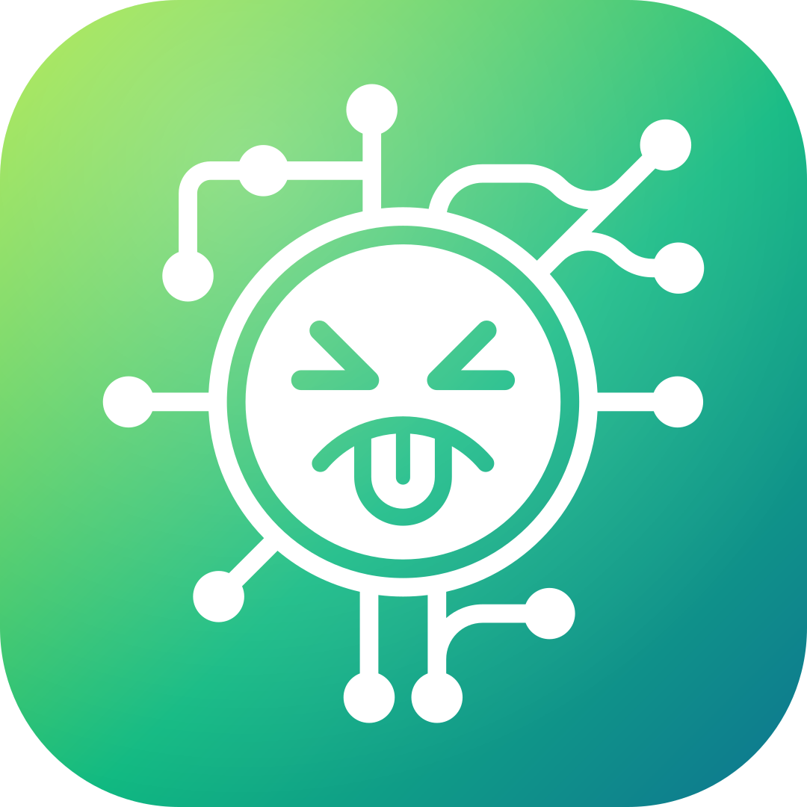
</p>

<h1 align="center">igitt</h1>

<p align="center"><a href="https://iam-peter.github.io/igitt/">iam-peter.github.io/igitt</a></p>

A Qt Quick git tool combining what gitk (history browsing) and git gui
(staging and committing) do, each in a mode of its own, plus the
operations neither of them offers — first of all folding working tree
changes into the commits not pushed yet, editing the history like `git
rebase -i` without touching the working tree, and composing several
commits at once from groups of related changes.


## Download

Every night with new commits, the
[nightly release](https://github.com/iam-peter/igitt/releases/tag/nightly)
is rebuilt for Linux (an AppImage), Windows and macOS. igitt runs the git
command line, so git 2.40 or newer has to be installed. The macOS app
isn't signed: open it with a right click and Open the first time.

On Debian and Ubuntu, igitt can come from its APT repository instead,
which brings its own Qt and installs git with it. It needs git 2.40, so
Ubuntu 24.04 or Debian 13 and newer:

```bash
sudo curl -fsSLo /usr/share/keyrings/igitt-archive-keyring.asc https://iam-peter.github.io/igitt/key.asc
echo "deb [signed-by=/usr/share/keyrings/igitt-archive-keyring.asc] https://iam-peter.github.io/igitt/apt stable main" | sudo tee /etc/apt/sources.list.d/igitt.list
sudo apt update && sudo apt install igitt
```

Put `nightly` in place of `stable` for the nightly builds.

## Building

Requires Qt ≥ 6.9, CMake ≥ 3.21 and git ≥ 2.40 at runtime. KDE's
KSyntaxHighlighting (KF6) is used for highlighting if CMake finds it, built
against the same Qt; `-DIGITT_USE_KSYNTAXHIGHLIGHTING=OFF` leaves it out.

```bash
cmake -B build -G Ninja -DCMAKE_PREFIX_PATH=$HOME/Qt/6.12.0/gcc_64
cmake --build build
ctest --test-dir build --output-on-failure
./build/bin/igitt [path/to/repo]
```

`cmake --install build` also installs a desktop file and the icon.

`tst_ui` saves screenshots of the window when `IGITT_SCREENSHOT_DIR` is set.

## Layout

- `src/core` — no Qt GUI dependency: `GitRunner` (runs the git CLI),
  parsers for log, refs, status and diffs, the graph lane layout, and
  `PatchBuilder`, which turns a line selection into a patch for `git apply`.
- `src/models` — list models over that data for QML.
- `src/core/StateLoader.*` — reads status, history and diffs into plain
  values on the git thread, from the repository or a plan's simulation.
- `src/core/FoldEngine.*`, `src/core/HistoryEditor.*` — folds and history
  edits, with the commit-level steps they share in `CommitRewriter`.
- `src/core/PlanSession.*` — plan mode: simulates actions, replays them,
  publishes the result.
- `src/Repository.*` — the facade QML talks to (QML module `Igitt.Core`).
- `src/qml`, `src/ui` — the UI (QML module `Igitt`), including the
  `CommitGraph` item that paints the history lanes.

All writes go through the git CLI so hooks, config and git's own checks
behave exactly as in a terminal.

git never runs on the UI thread. `Repository` queues every operation as a
job for a single background thread, which runs them one at a time in order:
writes never overlap, and every read sees the writes queued before it. Only
the UI thread touches the models, applying each job's result when it
arrives; results for a diff the user has already left are dropped.

## Modes

The window has a mode for each job, picked at the left of the tool bar or
with Ctrl+1, Ctrl+2 and Ctrl+3:

- **History** explores, as gitk does: the commit graph above, and below
  it the project's files beside the diff of the commit picked, or the
  history of the file picked.
- **Changes** commits, as git gui does: the changed files and the commit
  form beside their diff, under a strip of the commits not pushed yet.
  Changes are folded into those commits by dropping them on the strip.
- **Compose** reworks the commits not pushed yet together with the
  changes: groups of changes become commits, changes move between
  commits, and commits are reworded, moved, squashed and dropped.

The tool bar counts the changed files and the commits not pushed yet.
The modes lead into each other: the uncommitted changes on top of the
graph open Changes, a commit of the strip opens History, and a commit's
**Edit in Compose** shows it in Compose. Each mode keeps its own diff,
and the window opens on Changes when there are any.

## History

In the History mode, the commit graph follows GitKraken's and GitLens': branch and tag labels in their own
column, colored like their lane and linked to the commit; commits drawn
with the author's initials; uncommitted changes as a "// WIP" row on top,
connected to HEAD; and a Changes column with the number of files and a
bar of added and removed lines, loaded for the rows on screen. Columns
can be resized by dragging their header edge and picked from the View
menu or by right-clicking the header. Above it, an activity minimap shows
commits over time, the rows on screen and the selection; click it to
jump. The search takes `author:`, `message:` and `sha:`, quoted phrases,
and optional case-sensitive or regular-expression matching; Enter and
Shift+Enter jump between matches. `code:` searches the changes instead:
the commits that added or removed the text, as `git log -S` finds them,
or with regular expressions those that changed a line matching it
(`git log -G`).

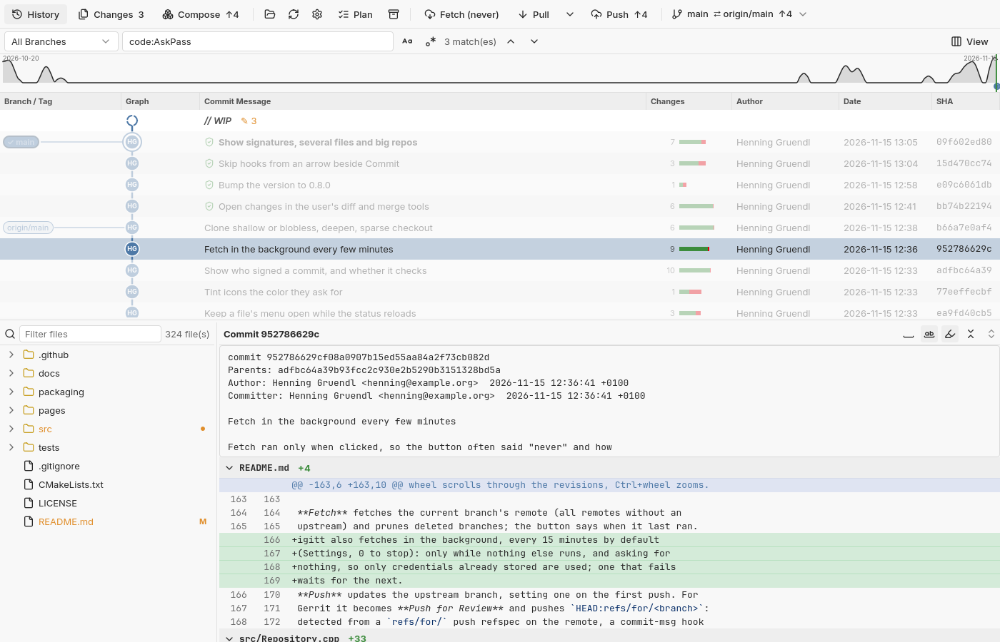 The scope selector limits the graph to
the current branch. Beside the diff, the project's files can be filtered
by name.

A file picked there shows its history below the graph instead of the
diff (see Time-lapse view), and the two go along: the graph dims the
commits that left the file alone, a revision picked selects its commit,
and a commit picked shows the file as it was then. The file's tool bar
opens it in a window of its own, or closes it for the diff again.

## Time-lapse view

Pick a file in the History mode's tree, or choose Time-lapse from a
file's menu in the change lists or a file header in any diff: it shows
below the graph, or in a window of its own. It is modelled on
Perforce's: a slider through every revision
of the file (following renames), and the file as it was at that revision
with each line blamed to the revision that last changed it, shaded by
age. The lines the revision added are green, the ones it edited orange,
and the ones it deleted red and struck through; clicking a line's
revision jumps there. The arrow keys step through the revisions, and
Play animates them; the lines in sight stay in sight, where the changes
between the revisions put them. A minimap right of the code shows the whole file
with the revision's changes in the same colors and the lines in sight;
click or drag it to scroll.

Switch on **Flow** to see the file's whole history as a Sankey diagram.
Each revision is a node as long as the file was then, line 1 at the top.
Between two nodes, kept lines flow in gray from their old place to their
new one, edited lines in orange all the way; removed lines narrow in
red to where they went and fade out, added lines widen in green from
where they came and fade in. A change belongs to the revision on the
right, which made it, and its bar shows its own changes. Click a node
to show that revision; on the current one, a marker shows the lines in
sight in the code, and clicking or dragging along it scrolls there. The
wheel scrolls through the revisions, Ctrl+wheel zooms.

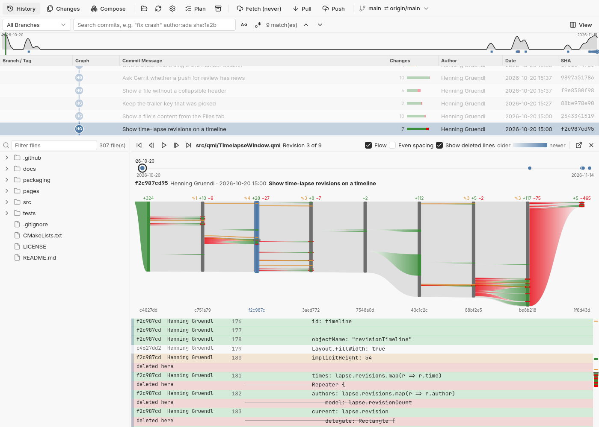

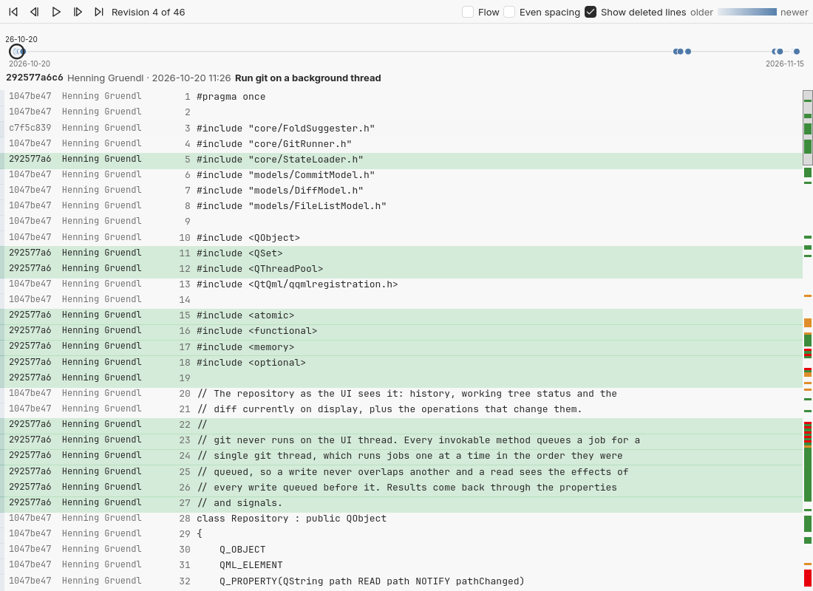

## Fetch, pull and push

**Fetch** fetches the current branch's remote (all remotes without an
upstream) and prunes deleted branches; the button says when it last ran.
**Push** updates the upstream branch, setting one on the first push. For
Gerrit it becomes **Push for Review** and pushes `HEAD:refs/for/<branch>`:
detected from a `refs/for/` push refspec on the remote, a commit-msg hook
that adds Change-Id, or Gerrit's SSH port, or chosen in Settings, where
the review branch can be set too. Gerrit's change links are shown after
pushing. A rejected push offers a force-push that uses
`--force-with-lease`, so it only replaces what was last fetched.

**Pull**, beside it, shows how far the upstream is ahead and runs `git
pull`: it merges the upstream, or rebases onto it, as `pull.rebase`,
`branch.<name>.rebase` and `pull.ff` say. The arrow next to it pulls
merging, rebasing or only fast-forwarding instead, and can put the
uncommitted changes aside meanwhile (`--autostash`) for every pull.

On GitHub and GitLab, recognized by the remote's host name (self-hosted
servers by other names are listed in Settings), the current branch's pull
or merge request shows on its tip: state, draft, review decision or
approvals, checks or pipeline, and unresolved threads, with details in its
tooltip and a click to open it. igitt asks with the `gh` and `glab`
command line tools, so their `gh auth login` and `glab auth login` are all
it takes; it keeps no tokens. The arrow next to Push sends GitLab's
merge request push options, or opens a pull request with `gh pr create`
after pushing to GitHub.

When the remote wants a user name, a password or a key's passphrase, or
SSH asks whether to trust a new host, igitt asks in a dialog: it is git's
and ssh's askpass program (`GIT_ASKPASS`, `SSH_ASKPASS`). git remembers
the answers only with a credential helper set up (`credential.helper`),
ssh with an agent. The buttons are off while planning, and Pull and Push
during a merge or rebase.

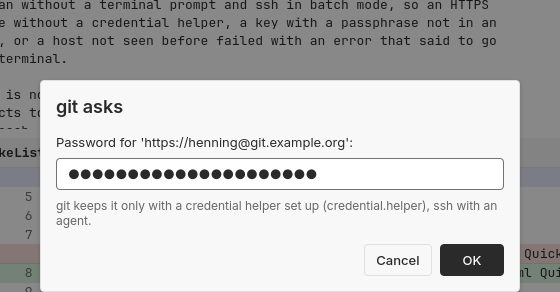

## Branches and tags

The branch in the tool bar opens a switcher: the local branches, then
the remote-tracking ones, filtered by what is typed, Enter switching to
the first. A remote-tracking branch switched to makes a local one that
tracks it. Switching keeps the uncommitted changes where git can carry
them over, and else leaves everything as it is and says which files are
in the way. A right-click on a branch there, or on its label in the
graph, switches to it, renames it or deletes it; a double-click on a
label switches too. A label also merges its branch into the current
one, rebases the current one onto it, makes a remote-tracking branch
the current one's upstream, or compares it with the current branch. A
merge asks how: as git is set up, always with a merge commit
(`--no-ff`), only fast-forwarding (`--ff-only`), or squashed into staged
changes to commit (`--squash`); the way chosen is asked first next time.

A commit's menu in History makes a branch there, switched to unless
unticked, or a tag, annotated when it has a message. Names are checked
as git checks them, and against those taken. A tag's label pushes it to
the upstream's remote, pushes every tag there, or deletes it.

A branch's label pushes it to any remote under any name, and tracks it
from then on if ticked. A remote-tracking branch's label deletes the
branch on its remote, after asking.

Deleting a branch asks for its name to be typed again: nothing here
brings it back, only the reflog. One that is not merged is deleted only
when that is ticked too. Branches and tags cannot be planned, and are
off while planning.

## Resolving conflicts

A conflicted file opens in the merge tool instead of a diff, after
GitKraken's: our side and theirs next to each other, labelled with their
commits, and a checkbox on each conflict to take its lines. Taking both
keeps them in the order they were picked. The output below follows the
choices and can be edited before **Save and Mark Resolved** writes and
stages it. Files that cannot be merged line by line (binary, or deleted
on one side) offer keeping one side instead. Folds and plans wait until
the merge, rebase or cherry-pick is finished.

A merge, rebase, cherry-pick or revert that stops at conflicts shows a
banner: once the conflicts are resolved and staged, **Continue** goes on
with it, and **Abort** puts everything back as it was.

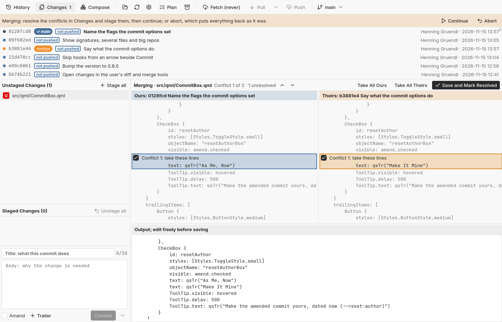

## Commit messages

The commit form has a title with a character counter, a body with a guide
at the wrap width, and trailer rows such as `Task-number: QTBUG-123`. The
message is put together as title, blank line, body, blank line, and one
contiguous trailer block. Settings… sets the title limit (50), the body
width (72), whether the body is wrapped on commit (bullets keep a hanging
indent; indented code and long URLs are left alone), and the trailer keys
the form offers. Amend splits the existing message back into the form,
trailers like Change-Id included, and As Me makes the amended commit the
user's, dated now (`--reset-author`). Skip Hooks commits once without the
pre-commit and commit-msg hooks (`--no-verify`). With `commit.template`
set, an empty form starts from the template, its comments left out, and
does not commit it unchanged.

## Reading diffs

Diffs and the project's files are highlighted: with KSyntaxHighlighting
when igitt is built with it, otherwise by a small built-in highlighter for
C++, QML/JavaScript, CMake, Python and Markdown. Where a removed line is
followed by its replacement, the words that changed are marked more
strongly, as on GitHub. Both are worked out on the git thread, and only up
to a limit (30,000 highlighted lines, 5,000 compared pairs, 2,000
characters per line), so big diffs stay quick. Lines are drawn as plain
text; nothing in a file is ever read as markup.

The diff toolbar turns highlighting and word marks off and on, and can
ignore changes of white space (`git diff -w`). Lines can't be staged or
folded while white space is ignored: such a diff would not apply back.

A file kept in Git LFS changes only its pointer in git; its diff says
what that means, the file added, removed or changed and its size before
and after. A repository with such files whose git-lfs is missing says
so when it is opened, and with git-lfs, the project's files lock and
unlock from their menu (`git lfs lock`).

## Staging

In the Changes mode, as in git gui: click lines to select them (Shift+click for a range, a hunk
header for the whole hunk) and stage or unstage the selection, or
right-click a line for Stage Hunk and Stage Line. Double-click a file, or
click its status badge, to stage or unstage all of it. Ctrl+click and
Shift+click pick several files in a change list; their menu stages,
unstages, discards or stashes them together.

An untracked file's menu ignores it: the file alone, every file with its
extension, its folder, or its name anywhere, or a pattern written by
hand; in `.gitignore`, shared with everyone, or only in this clone's
`.git/info/exclude`.

## Discarding and stashing

A file's unstaged changes are discarded from its menu in the change
lists, an untracked file deleted; the lines selected in the unstaged
diff from the diff's tool bar. Nothing keeps what is discarded, so it
asks first; staged changes stay. Delete Untracked Files, in the same
menu, lists what `git clean` would delete, ignored files too if ticked,
and deletes those and nothing made since.

The stash button in the tool bar, with how many there are, stashes the
changes under a message, untracked files too if ticked, or only what is
staged (`--staged`), which is how to stash some lines: stage them first.
A file's menu stashes only its changes. The button lists the stashes:
each applied again and kept, popped, or dropped, which asks first.

## Plan mode

With **Plan** switched on, write actions (staging, unstaging, commit,
amend, fold, history edits, and the commits and moves of composing) are
not carried out but collected in a plan. Each one is
simulated on a scratch copy of the index and a simulated HEAD, so the
history, file lists and diffs show the result, with planned commits
tagged. Every entry lists the git commands it ran, with patches and
messages; removing one replays the rest, and flags entries that no longer
apply.

None of these actions touch the working tree, which makes the simulation
exact. **Execute** therefore runs nothing again: it publishes the reviewed
result, moving HEAD with `git update-ref` and replacing the index under
git's own `index.lock`. It refuses, changing nothing, if HEAD or the index
were changed by anything else since planning began.

Branches, tags, pulls, merges and rebases, discarding, stashes,
cherry-picks, reverts, resets and bisecting are not planned: they are
off while planning, and say so.

Commit hooks (pre-commit, prepare-commit-msg, commit-msg) run when a
commit is planned, so the plan shows the message they produce, Change-Id
included. Staging a file records the file as it was at that moment.

## Folding changes into an earlier commit

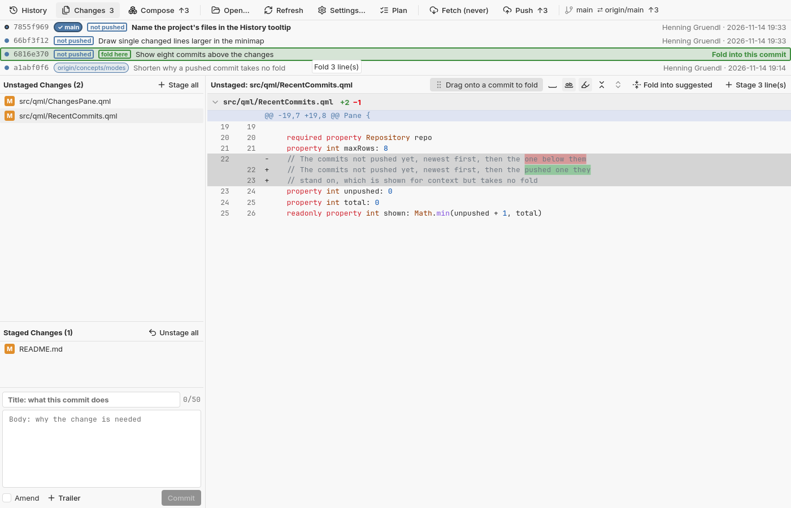

In the Changes mode, select lines in the unstaged or staged diff, then
drag the "Drag onto a commit to fold" handle onto a commit in the strip
above, which lists the commits not pushed yet and the pushed one they
stand on. A file dragged out of the change lists onto a commit folds all
its lines. The commit under the pointer turns green, or red with the
reason where it cannot take the fold. This is the interactive form of `git commit --fixup=<sha>` followed
by `git rebase -i --autosquash <sha>~`, done by `FoldEngine` without
touching the working tree:

1. Apply the selected lines to their base tree (HEAD for staged lines, the
   index for unstaged ones) in a temporary index.
2. Merge that change into the target with `git merge-tree --write-tree
   --merge-base=<base>` and recreate the target with its author, date and
   message, signed when `commit.gpgSign` is set, as `git commit` would.
3. Replay every later commit the same way.
4. Move HEAD with `git update-ref HEAD <new> <old>`, which fails if the
   branch moved meanwhile. Unstaged lines that were folded are staged, so
   they don't show up as changes any more.

A conflict in steps 1–3 aborts with nothing changed. Commits already on a
remote branch ask for confirmation first. Undo restores the branch and the
index as long as HEAD hasn't moved since; the reflog has every fold too
("igitt: fold into …").

While lines are selected, igitt suggests the commit they belong in, the
way `git absorb` does: `FoldSuggester` blames the lines each change modifies
or borders and picks the newest local commit among them, since folding into
an older one would conflict with it. Local commits are those after the
merge base with the upstream branch and after the last merge commit. The
suggested commit is tagged "fold here" in the strip, and "Fold into
suggested" folds into it. A selection spanning several commits, or touching
lines that are only staged, gets no suggestion, with the reason shown
instead.

Not supported yet: merge commits between the target and HEAD, and moving
other branches that point into the rewritten range (like `rebase
--update-refs`).

## Picking, reverting, resetting and comparing

A commit's menu in History picks it onto the current branch, reverts it
with a new commit, or resets the current branch to it; a merge commit is
picked or reverted by its first parent's side. Resetting asks whether to
keep what the later commits changed staged, unstaged, or to throw it
away with every uncommitted change, which turns the button red. A
commit the branch has already is not picked again. Ctrl+click marks
several commits, which the menu then picks together, oldest first,
leaving out those whose changes the branch has.

"Move onto This", on a commit or a label, moves the current branch's
commits after a point picked in the dialog onto it, as `git rebase
--onto` does: the commits up to the point stay behind.

The same menu compares the commit with the one on display, and saves it
as a patch, as `git format-patch` writes it. It also checks the commit
out on no branch (detached HEAD), to look at or build an old version, as
a tag's label does for its tag; switching to a branch goes back.

## Editing the history

In the Compose mode, each commit's column has a menu, from the button
beside its subject or a right-click on its header: **Reword…**, **Move
Earlier**, **Move Later**, **Squash into the One Before**, **Fix Up into
the One Before** (keeping only the earlier commit's message) and
**Drop…**. A commit a remote branch has, or one an edit cannot reach,
says why not. This is `git rebase -i` done by `HistoryEditor`, the same
way folds are done:

1. Replay the commits from the oldest one the edit affects up to HEAD in
   their new order, each with `git merge-tree --write-tree
   --merge-base=<its old parent>` onto its new parent, recreating it with
   its author, date and message. Commits below the edit keep their ids.
2. Move HEAD with `git update-ref HEAD <new> <old>`.
3. Carry the index over with `git read-tree -m -i <old> <new>`: what was
   staged stays staged, and since the working tree is not touched, what a
   dropped commit changed shows up as uncommitted changes.

Rewording opens the commit form with the message split into title, body
and trailers; a Change-Id that goes missing is put back, and squashing
keeps only the first commit's. A conflict aborts with nothing changed,
editing a commit already on a remote branch asks first, and dropping
always does. Undo works as for folds, and the reflog has every edit
("igitt: reword …", "igitt: move …"). The same restrictions apply: no
merge commits between the edited commit and HEAD, though a merge commit
itself can be reworded.

## Composing commits

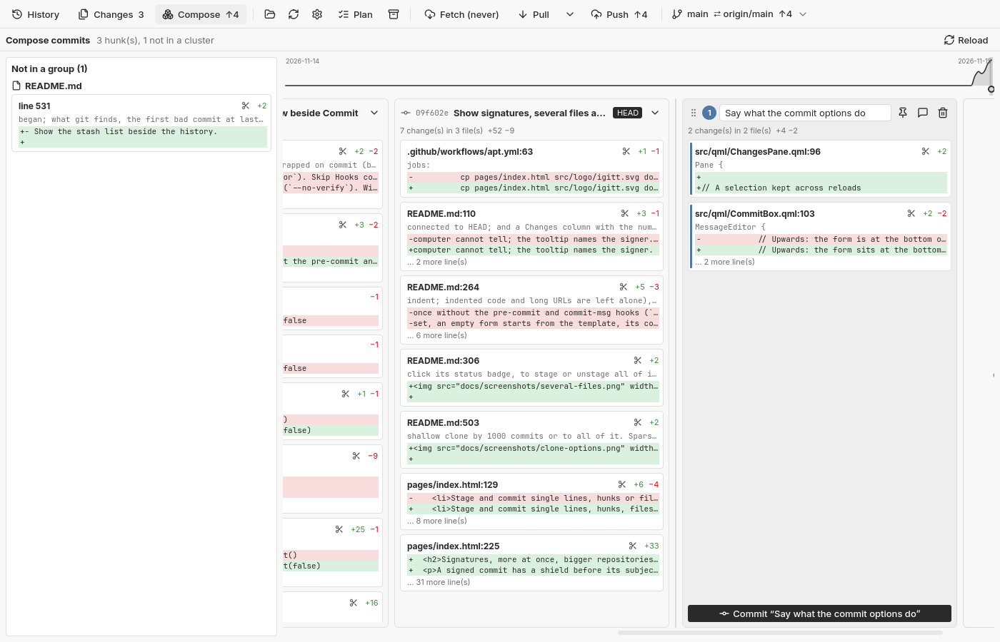

The Compose mode puts commits together by what they are about rather
than by file. Every changed line between HEAD
and the working tree, staged or not and untracked files too, is a card on
the left. Drag cards into groups, one per commit to be: a group has a
title and a whole message, written as in the commit form, and is
committed on its own; the groups stand in the order they are committed,
and their grips move them. The staging area is not used, and committing a
group leaves the other changes where they are.

The scissors on a card open it in place to split a hunk by lines: a click
picks a line, Ctrl+click adds one, Shift+click a range, a drag picks the
lines it goes over and Ctrl+A all of them. Dragging what is picked
carries those lines out, onto a group or the place for a new one, while
the rest of the hunk stays open to split further; Esc closes it.

Left of the groups, scrolled to with Shift and the wheel, the bar beneath
or the timeline above, are the commits of the branch that are not merged
yet: those the remote's default branch (or else the upstream) does not
have, down to the last merge. Their changes are cards too, and what is
dragged between the columns is moved in the history:

- A change of the working tree dropped onto a commit is folded into it.
- A change of a commit dragged onto a group, or back to the changes on
  the left, leaves the commit; since the working tree is not touched, it
  is an uncommitted change now, in that group.
- A change of one commit dropped onto another moves there; the tree at
  the end is the one at the start.

Each move is done like a fold, with `git merge-tree` and `git
commit-tree` for the commits it affects and nothing changed if one of
them conflicts, and Undo takes it back. A commit that a remote branch
already has is marked pushed and stays as it is, since changing it would
need a force push: what is held over it gets a red border instead. A
change pushed only for review, to Gerrit's `refs/for`, is on no remote
branch and can be changed, which makes a new patch set. Pinning a group
keeps it in sight at the side while the board scrolls back through the
history. In plan mode, commits and moves go into the plan.

## The repository

The folder button in the tool bar is a menu for the repository: open
one, clone one into a folder of its name, or make a new one, each opened
once there; its remotes, each renamed, pointed elsewhere or removed, and
new ones; its worktrees, each opened here or removed, and new ones on a
new or an existing branch; updating its submodules, where there are
any; and applying a patch, as a commit when `git format-patch` wrote it
(undone whole if it does not apply), else to the working tree. Removing
a remote or a worktree asks first.

**Recover Lost Work** lists where HEAD was, from its reflog, and the
commits nothing refers to any more: the tip of a branch deleted, a
stash dropped, what a reset or an amend left behind. By default only
what no branch, tag or stash has. Each shows in History, becomes a
branch again, or the place the current branch is reset to; a dropped
stash goes back among the stashes. git keeps them until `gc.reflogExpire`
and `gc.pruneExpire` are over.

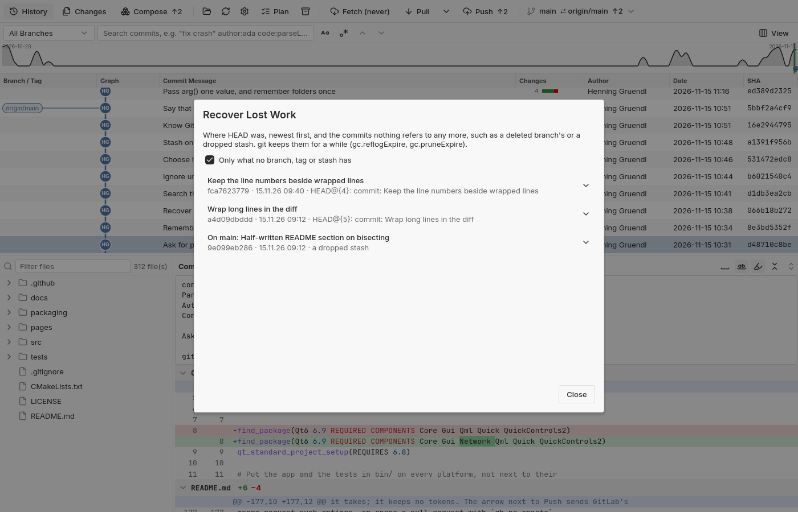

igitt remembers the last twelve repositories it opened, under Open
Recent. Started outside a repository, or with none to open, it shows a
start page with them, besides Open, Clone and New Repository; a
repository whose folder is gone stays listed until it is forgotten.

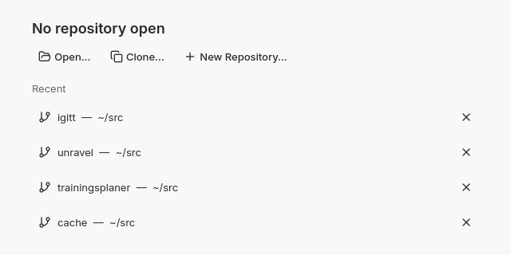

## Bisecting

A commit's menu marks it good or bad for `git bisect`, which starts a
bisection if there is none. While bisecting, a banner asks whether the
commit checked out is good or bad, skips it, or stops, back where it
began; what git finds, the first bad commit at last, is its message.

## Ideas

- Split an ambiguous selection and fold each part into its own commit.

## Appearance

The interface uses Inter and code JetBrains Mono, both bundled; Settings
can change either and their sizes. Files in a diff collapse and expand by
clicking their header, or all at once from the diff's toolbar.

igitt draws its controls in a style of its own and takes all its colors
from a theme: Light, Dark, Dracula, Alucard and the four Catppuccin
flavors come with it. Settings picks one, or System for Light or Dark as
the system is. Themes of your own are JSON files in igitt's theme
folder, read again as soon as they change; see
[docs/THEMES.md](docs/THEMES.md).

<p>
  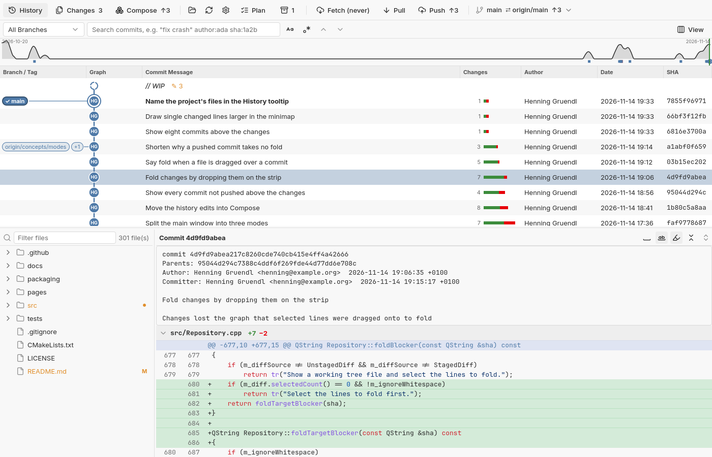
  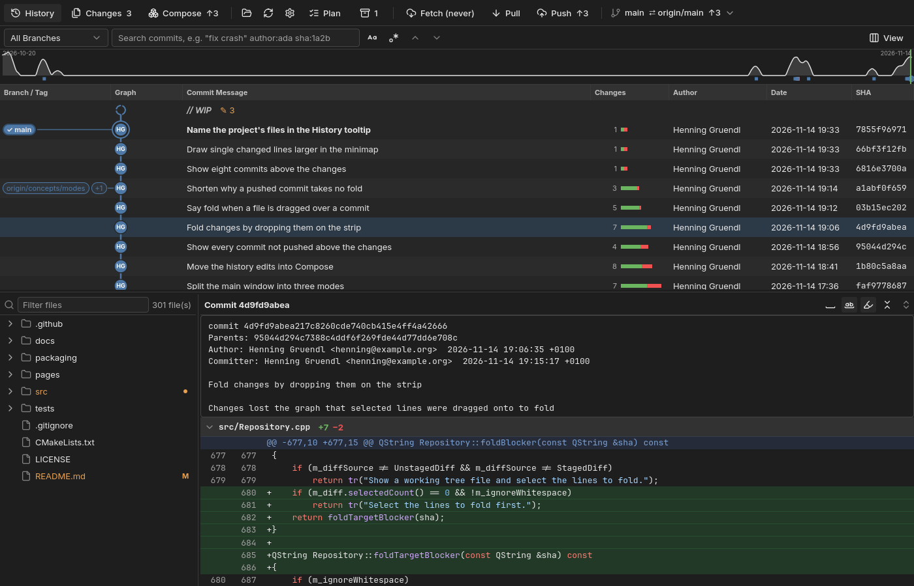
  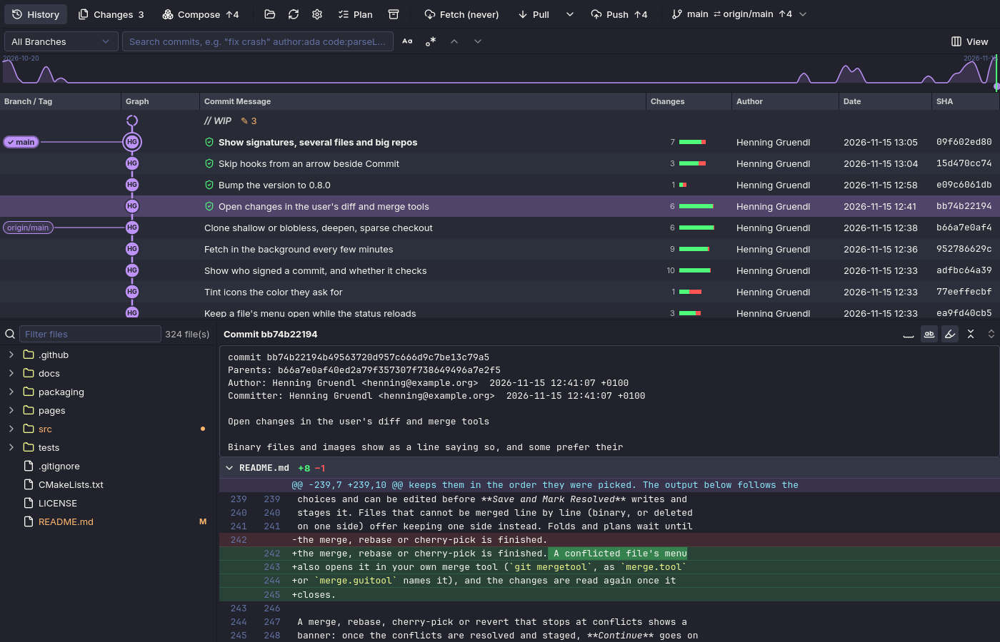
  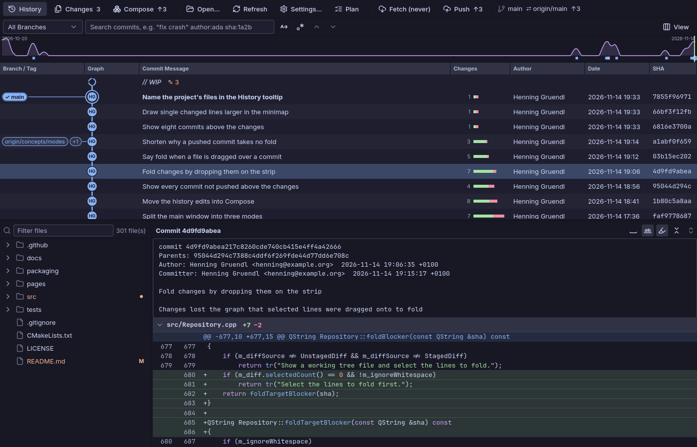
</p>

## Third-party assets

- Icons: [Lucide](https://lucide.dev), ISC license (`src/icons/LICENSE.txt`).
- Fonts: [Inter](https://rsms.me/inter/) and
  [JetBrains Mono](https://www.jetbrains.com/lp/mono/), SIL Open Font
  License 1.1 (`src/fonts/`).
- Themes: the palettes of [Dracula](https://draculatheme.com) and
  [Catppuccin](https://catppuccin.com), MIT license; the controls' style
  started out after [shadcn/ui](https://ui.shadcn.com), MIT license.

## License

igitt is released under the MIT license; see `LICENSE`. The third-party
assets above keep their own licenses.
